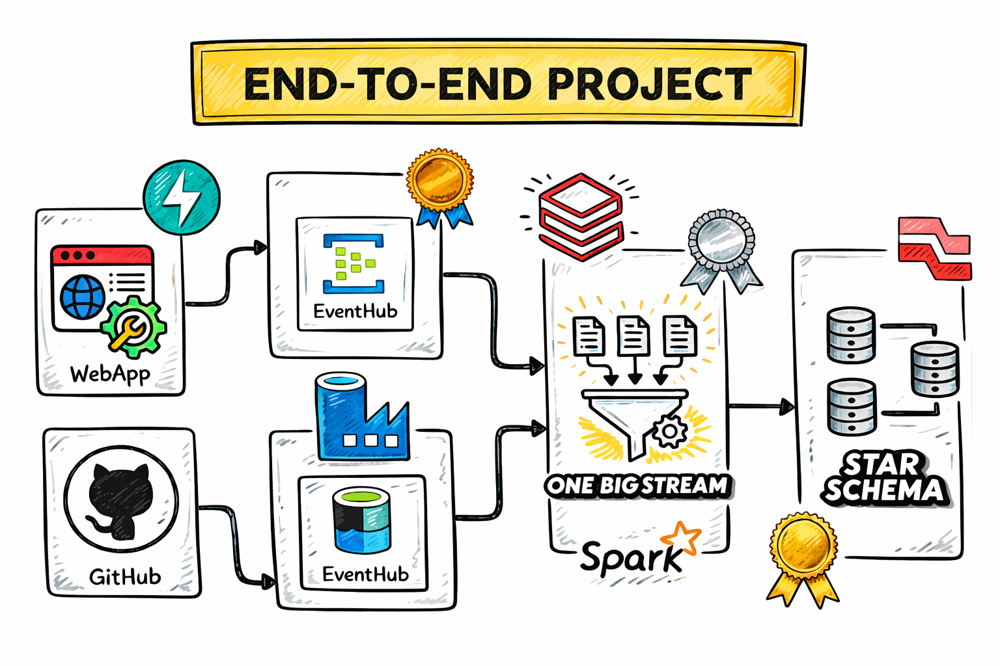
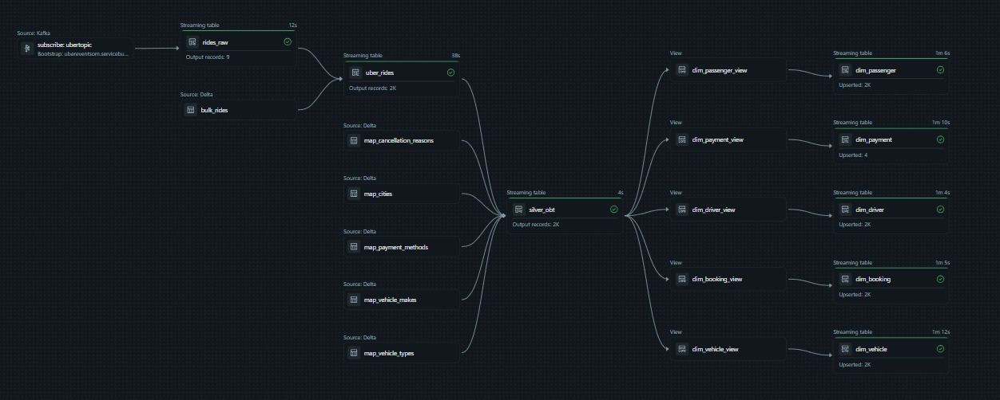
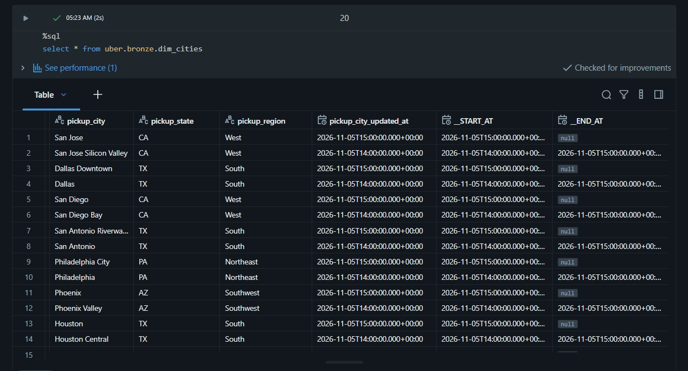

# Uber Ride Data Engineering Project (Azure + Databricks)

An end-to-end streaming and batch data engineering project on Azure. It generates synthetic Uber ride bookings, streams them through Event Hubs into Databricks, and models them into a star schema using Lakeflow Declarative Pipelines (Delta Live Tables), including an SCD Type 2 dimension.

## Architecture



**Flow:**
1. **Generator and website** create fake ride bookings (FastAPI `/book` endpoint or `connection.py`) and send them to **Azure Event Hubs**.
2. **Azure Data Factory** copies the bulk ride file and the lookup (map) files from GitHub to **Azure Blob Storage** (`raw/ingestion`).
3. A **Databricks notebook** loads those files into Delta tables in Unity Catalog (`uber.bronze`).
4. A **Databricks pipeline** reads Event Hubs (Kafka protocol), parses the events, joins the lookups, and builds the dimension and fact tables.

## Tech stack

Azure Event Hubs, Azure Data Factory, Azure Blob Storage, Azure Databricks (Unity Catalog, Lakeflow Declarative Pipelines, PySpark, Spark SQL), Delta Lake, Python (Faker, FastAPI, azure-eventhub), Jinja2, GitHub.

## Data

Synthetic ride-confirmation JSON with about 50 fields per ride:
- **IDs:** ride, passenger, driver, vehicle, confirmation number
- **Foreign keys:** vehicle type, vehicle make, payment method, ride status, pickup and dropoff city, cancellation reason
- **People and vehicle info:** names, email, phone, rating, license, model, color, plate
- **Locations:** addresses and lat/long across 10 US cities
- **Measures:** distance, duration, booking/pickup/dropoff timestamps
- **Pricing:** base, distance and time fare, surge multiplier, subtotal, tip, total fare
- **Status:** about 10% of rides are cancelled with a reason

Lookup tables (`Data/map_*.json`): cities, cancellation reasons, payment methods, ride statuses, vehicle makes, vehicle types. Plus `bulk_rides.json` as the initial historical load.

## Pipeline layers

| Layer | Objects | Description |
|---|---|---|
| Ingestion | `rides_raw` | Streams raw JSON events from Event Hubs (Kafka endpoint) |
| Bronze | `uber_rides`, `map_*`, `bulk_rides` | `uber_rides` is fed by a one-time bulk flow and a streaming flow that parses JSON with an explicit schema |
| Silver | `silver_obt` | One Big Table: rides streamed and left-joined to all lookup tables. The SQL is generated from a metadata-driven Jinja template |
| Dimensions | `dim_passenger`, `dim_driver`, `dim_vehicle`, `dim_payment`, `dim_booking`, `dim_cities` | Built with `create_auto_cdc_flow`. Most are SCD Type 1. **`dim_cities` is SCD Type 2** (history tracked with `__START_AT` / `__END_AT`) |
| Fact | `fact_rides` | Ride measures (distance, duration, fares, tip, rating) |

### Pipeline DAG



### SCD Type 2 in action

City renamed from *San Jose* to *San Jose Silicon Valley*: the old row is closed with `__END_AT` and a new version is opened with `__START_AT`.



## Key concepts demonstrated

- Streaming ingestion from Event Hubs with Structured Streaming
- Bulk plus streaming loads into one table using append flows
- Schema enforcement with `from_json`
- Stream-to-static joins and watermarks
- Metadata-driven SQL generation with Jinja
- Auto CDC flows, SCD Type 1 and Type 2
- Handling schema changes and full refresh in declarative pipelines

## Repository structure

```
Code_Files/    Databricks code (ingest, silver, model, notebooks)
DataBricks/    Databricks notebooks and pipeline source files
Data/          bulk_rides.json and map_*.json
templates/     Web page for the booking website
api.py         FastAPI app with the /book endpoint
connection.py  Sends rides to Event Hubs
data.py        Fake ride generator and lookup definitions
```

## How to run

1. Create a `.env` file with `CONNECTION_STRING` and `EVENT_HUBNAME` (never commit it).
2. Run the ADF pipeline `HttpFromGithub` to copy the data files to storage.
3. Run the bronze notebook to load the map tables and bulk rides.
4. Send rides: `python connection.py` or call the `/book` endpoint.
5. Run the Databricks pipeline (normal refresh).

**Updating a lookup file:** commit to GitHub, run ADF, run the bronze notebook, then run the pipeline.

## Notes

- Don't full refresh `dim_cities`, because it would erase the SCD 2 history.
- Secrets (Event Hub connection string, storage SAS token) are not stored in the repo.
